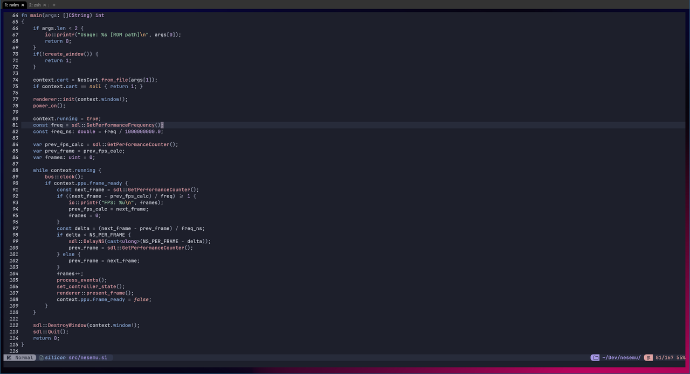

# SiliconC (sic) Compiler

A statically-typed, LLVM-based systems programming language and compiler with modern syntax, and ease of use while
simultaneously being explicit.

## Overview

Silicon is a custom programming language developed entirely by me, and sic is a (currently linux only) compiler for
that language designed as both a personal project as well as a compiler ready for real use. My primary goal of
creating the project is to explore modern compiler architecture, optimization techniques, and systems-level language 
design. I am an avid user of the C language, but the more you master the language, the more you realize just how many 
wrinkles exist from its 50 year history. Silicon is similar to modern languages like Zig and Rust, but takes a more 
simple approach to certain ideas, which is a tradeoff with safety and convenience at times.

The project focuses on:
- Optimized cache-efficient compiler internals
- Static analysis, type coercion, constant folding
- LLVM IR generation and optimization
- Interoperability with C
- Language designed for systems programming

## Examples

This is a simple example of printing something in the langauge. As you can see, as of right now there is no
standard library yet with a print function, so we instead use the standard C library's printf function. The reason
for this is simply that I am still working on the language and developing a standard library when I can, but I am
only one person, so I don't have a lot of time to get stuff going.

```silicon
extern fn printf(fmt: *const char, ...);

fn main() void {
    const x: int = 10;
    const y = x * 2;
    printf("Hello, World! %d\n", y);
}
```

For a more thorough example of what the language can do, I implore you to check out the [repository for a NES emulator that I made entirely in silicon.](https://github.com/ThatOneDamien/nesemu)




## Docs

I have not yet had the time to write out full documentation for the langauge, as I am also changing the langauge as I develop the compiler, but it is being worked on.

## Compiler Architecture

SiliconC is structured as a multi-pass compiler:

### 1. Lexer  
    Tokenizes source code into a stream of tokens. Something like:
    
    fn main() void {} 

    turns into TOKEN_FN TOKEN_IDENT TOKEN_LPAREN TOKEN_RPAREN TOKEN_VOID TOKEN_LBRACE TOKEN_RBRACE.


    Raw Source Files -> Token Stream

### 2. Parser  
    Builds an AST (Abstract Syntax Tree) using recursive descent parsing. This takes the token stream from the lexer and builds nodes such as Stmt, Expr, Object, ObjFunc, ObjVar, etc. So the function from the previous statement will be parsed as a top level statement, and the main function will be created as an ObjFunc structure, with its values assigned as needed. Nested statements and expressions are then handled until a tree is built which is ready to be analyzed by the next stage.


    Token Stream -> Untyped AST

### 3. Semantic Analysis
    By far the most complex and important stage in the compiler. It begins by resolving imports and modules, resolving symbols, and then type checking. With the function example yet again, the semantic analyzer will check for conflicting symbols in the module, then check for any parameters, then begin to check the body of the function. Semantic analysis also performs a number of optimization steps including constant folding and compile-time expression reduction that assist the IR generation in making the final produced code to be as efficient as possible.


    Untyped AST -> Typed AST

### 4. IR Generation  
    After analyzing and fully-typing the AST, the IR generation stage will take the nodes of the tree and create LLVM intermediate representation with calls to the LLVM library via the LLVM-C api. The IR that is generated is then output as specified by the user via the invokated command line.

    
    Typed AST -> LLVM IR

### 5. Optimization Passes  
    The LLVM IR that is generated then goes through a number of optimization passes which include steps such as function inlining, constant folding, instruction collapsing, loop unwinding, etc. This is a very important step in making the code generated efficient and correct rather than just correct.


    LLVM IR -> Optimized LLVM IR

### 6. Final Code Generation  
    The LLVM backend for the specified compilation target will then take the LLVM IR generated by the previous step and generate optimized native machine code for the target. This machine code is packaged depending on the target, but it is expected to be an object file (.o files on linux). The code that is generated is then ready for the final stage where the output is created.


    Optimized LLVM IR -> Target Object File

### 7. Linking
    The code generated from the codegen stage is then finally linked together using the system linker of the host machine, packing the code from various modules and other linked libraries together to form the final executable/library. Now the code is ready to run!


    Target Object File + Libraries -> Target Executable/Library

## Future Feature Plans (sorted from highest to lowest priority)
- More test cases
- Adding bitfields (data type)
- Optionals + optional arithmetic
- Defer statements
- Interfaces?
- For loop improvements
- Build system
- std library
- Macros/constant-eval functions
- Generics
- Add support for float80/float128 (refactoring)
- Self hosting

## Related Links
- NES Emulator in silicon: https://github.com/ThatOneDamien/nesemu
- Tree-sitter parser + queries for highlighting in Neovim: https://github.com/ThatOneDamien/tree-sitter-silicon